# Transactional Outbox Starter Module (`module/messaging/outbox`)

A production-ready, Spring Boot starter implementing the **Transactional Outbox Pattern**. It guarantees reliable event publishing from relational databases to message brokers (e.g., Kafka, RabbitMQ) with **at-least-once delivery semantics**, **zero distributed transactions (XA)**, **pessimistic row-level leasing**, **exponential backoff with jitter**, **dead-lettering**, and **automated data retention purging**.

---

## High-Level Architecture Diagram

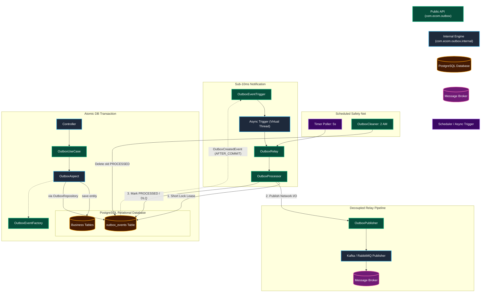

---

## Detailed File-by-File Breakdown: Why, What, & How (With Zoomed Detail Flows)

Every file in this module has a single, well-defined responsibility.

---

<a id="outbox-use-case"></a><a id="domain-event"></a>
### 1. `OutboxUseCase<C, R>` (`com.ecom.outbox`) & `DomainEvent` (`com.ecom.shared.messaging`)

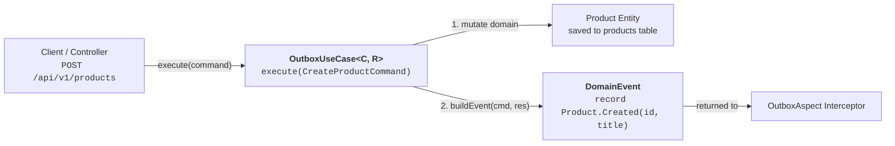

* **Why**: To provide a clean, declarative programming model for application developers. Business use cases need to emit events without manually writing boilerplate SQL or managing outbox entity lifecycles.
* **What**: 
  * `OutboxUseCase<C, R>`: An interface extending `com.ecom.shared.usecase.CommandUseCase<C, R>`, adding the `DomainEvent buildEvent(C cmd, CommandResult<R> result)` contract.
  * `DomainEvent` (`com.ecom.shared.messaging`): Shared contract defining `String aggregateId()`. Aggregate domain events are defined as nested Java records inside an aggregate interface (e.g., `Product.Created(String id, String title) implements DomainEvent`).
* **How**: Developers implement `OutboxUseCase` on their command use case classes. If `buildEvent(...)` returns non-null, `OutboxAspect` automatically serializes and commits the event into `outbox_events` within the use case transaction. If it returns `null`, outbox recording is skipped.

---

<a id="outbox-aspect"></a><a id="outbox-created-event"></a>
### 2. `OutboxAspect` & `OutboxCreatedEvent` (`com.ecom.outbox.internal.aspect`)

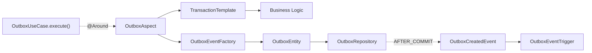

* **Why**: To enforce transaction atomicity. An outbox event must commit if and only if the underlying business mutation commits. Writing to the event table manually risks forgotten saves or partial failures.
* **What**: 
  * `OutboxAspect`: AspectJ around advice (`@Aspect`) intercepting `OutboxUseCase+.execute(..)`.
  * `OutboxCreatedEvent`: Internal Spring `ApplicationEvent` holding the `UUID outboxId` of the committed record.
* **How**: 
  1. Wraps invocation in `TransactionTemplate`.
  2. Executes business code: `joinPoint.proceed()`.
  3. Calls `useCase.buildEvent(command, result)`.
  4. Serializes the event via `OutboxEventFactory`.
  5. Saves `OutboxEntity` with status `PENDING`.
  6. Fires `OutboxCreatedEvent` via Spring's `ApplicationEventPublisher`.

---

<a id="outbox-event-factory"></a><a id="default-outbox-event-factory"></a>
### 3. `OutboxEventFactory` & `DefaultOutboxEventFactory`

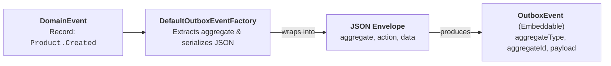

* **Why**: To safely validate and transform strongly-typed Java objects into standardized, size-capped JSON envelopes before persistence.
* **What**: 
  * `OutboxEventFactory` (`com.ecom.outbox`): Public factory contract.
  * `DefaultOutboxEventFactory` (`internal.aspect`): Default implementation.
* **How**:
  1. Validates that the event is a record nested inside an aggregate interface.
  2. Extracts `aggregateType` (declaring class simple name) and `action` (record class simple name).
  3. Enforces non-blank `aggregateId`.
  4. Wraps in `Envelope(aggregate, action, data)` and serializes using Jackson `ObjectMapper`.
  5. Verifies payload does not exceed `outbox.max-payload-length` (default: 64 KB).

---

<a id="outbox-event-trigger"></a><a id="default-outbox-event-trigger"></a>
### 4. `OutboxEventTrigger` & `DefaultOutboxEventTrigger`

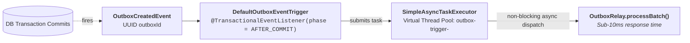

* **Why**: To achieve sub-millisecond, near real-time event dispatching without waiting for the background polling tick.
* **What**: 
  * `OutboxEventTrigger` (`com.ecom.outbox`): Public trigger interface.
  * `DefaultOutboxEventTrigger` (`internal.relay`): Default implementation.
* **How**: Listens to `OutboxCreatedEvent` with `@TransactionalEventListener(phase = TransactionPhase.AFTER_COMMIT)`. Dispatches `relay::processBatch` to `SimpleAsyncTaskExecutor` configured with Java Virtual Threads (`setVirtualThreads(true)`).

---

<a id="outbox-relay"></a><a id="default-outbox-relay"></a>
### 5. `OutboxRelay` & `DefaultOutboxRelay`

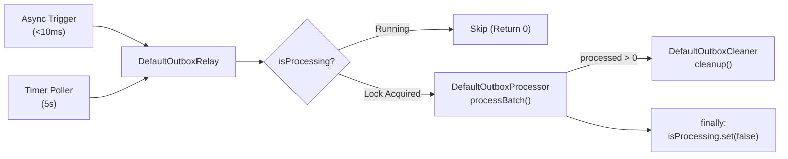

* **Why**: To coordinate execution between real-time event triggers and timer pollers while preventing concurrent execution collisions on the same node.
* **What**: 
  * `OutboxRelay` (`com.ecom.outbox`): Public orchestrator contract.
  * `DefaultOutboxRelay` (`internal.relay`): Default implementation with `AtomicBoolean isProcessing`.
* **How**: Uses `compareAndSet(false, true)` to ensure that if a batch is already in progress, overlapping trigger requests exit immediately. Delegates batch processing to `OutboxProcessor` and releases the guard in a `finally` block.

---

<a id="outbox-processor"></a><a id="default-outbox-processor"></a>
### 6. `OutboxProcessor` & `DefaultOutboxProcessor`

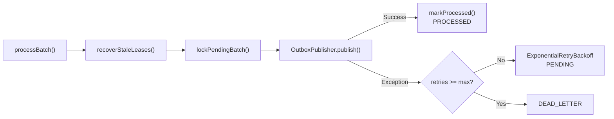

* **Why**: To encapsulate the core business logic of outbox processing: leasing, broker dispatching, retries, and lease recovery.
* **What**: 
  * `OutboxProcessor` (`com.ecom.outbox`): Public processing contract (`processBatch()`, `recoverStaleLeases()`, `replayDeadLetterEvents()`).
  * `DefaultOutboxProcessor` (`internal.relay`): Default processing engine.
* **How**:
  1. Recovers expired in-flight leases left by crashed nodes.
  2. Runs a `do-while` loop claiming pending records with pessimistic write locks (`SELECT ... FOR UPDATE`).
  3. Dispatches via `OutboxPublisher`.
  4. On success: marks `PROCESSED`. On error: schedules retry via `RetryBackoffStrategy` or transitions to `DEAD_LETTER`.

---

<a id="outbox-publisher"></a><a id="outbox-message"></a><a id="default-outbox-message"></a>
### 7. `OutboxPublisher` & `OutboxMessage` (`com.ecom.outbox`) / `DefaultOutboxMessage` (`internal.relay`)

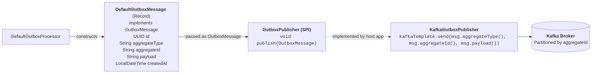

* **Why**: To decouple the outbox module from any concrete message transport (Kafka, RabbitMQ, SQS, Google PubSub), while strictly guaranteeing that root API contains **interfaces only** and internal packages encapsulate concrete implementations.
* **What**: 
  * `OutboxPublisher` (`com.ecom.outbox`): Functional interface SPI defining `void publish(OutboxMessage message) throws Exception`.
  * `OutboxMessage` (`com.ecom.outbox`): Public pure interface defining `id()`, `aggregateType()`, `aggregateId()`, `payload()`, and `createdAt()`.
  * `DefaultOutboxMessage` (`com.ecom.outbox.internal.relay`): Immutable record implementation fulfilling the `OutboxMessage` contract.
* **How**: Host applications implement `OutboxPublisher` consuming the `OutboxMessage` interface. `DefaultOutboxProcessor` instantiates `DefaultOutboxMessage` internally and passes it across the SPI boundary. If no publisher bean is registered, events remain safely `PENDING`.

---

<a id="retry-backoff-strategy"></a><a id="exponential-retry-backoff"></a>
### 8. `RetryBackoffStrategy` & `ExponentialRetryBackoff`

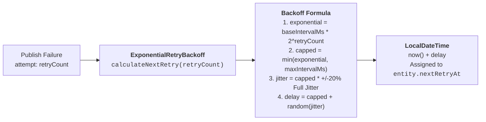

* **Why**: To prevent cascading broker overloads (thundering herd problem) during downstream outages with randomized backoff.
* **What**: 
  * `RetryBackoffStrategy` (`com.ecom.outbox`): Public strategy interface defining `LocalDateTime calculateNextRetry(int retryCount)`.
  * `ExponentialRetryBackoff` (`internal.relay`): Default implementation.
* **How**: Computes exponential delay capped at `outbox.retry.max-interval-ms` (default: 5 min) and adds $\pm 20\%$ randomized full jitter.

---

<a id="outbox-cleaner"></a><a id="default-outbox-cleaner"></a>
### 9. `OutboxCleaner` & `DefaultOutboxCleaner`

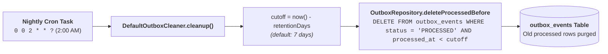

* **Why**: To prevent unbounded table growth in high-throughput applications and maintain fast index performance.
* **What**: 
  * `OutboxCleaner` (`com.ecom.outbox`): Public cleaner contract (`void cleanup()`).
  * `DefaultOutboxCleaner` (`internal.relay`): Default implementation.
* **How**: Scheduled via cron expression (default: 2:00 AM daily). Bulk-deletes `PROCESSED` rows older than `outbox.cleaner.retention-days` (default: 7 days).

---

<a id="outbox-persistence"></a><a id="outbox-entity"></a><a id="outbox-event"></a><a id="outbox-status"></a><a id="outbox-repository"></a>
### 10. `OutboxEntity`, `OutboxEvent`, `OutboxStatus`, & `OutboxRepository` (`internal.persistence`)

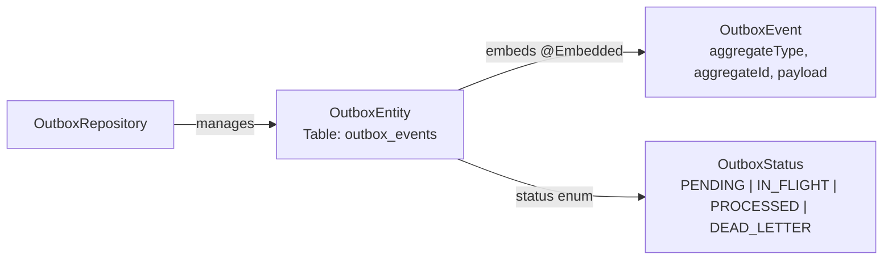

* **Why**: To model the relational database storage schema and provide optimized queries for pessimistic locking and bulk maintenance.
* **What**: 
  * `OutboxEntity`: JPA entity mapped to `outbox_events`.
  * `OutboxEvent`: `@Embeddable` Value Object storing payload and aggregate IDs.
  * `OutboxStatus`: Enum representing the lifecycle states (`PENDING`, `IN_FLIGHT`, `PROCESSED`, `DEAD_LETTER`).
  * `OutboxRepository`: Spring Data repository with `lockPendingBatch`, `releaseStaleInFlight`, `deleteProcessedBefore`, and `replayDeadLetter`.
* **How**: Configured with composite database indexes on `(status, created_at)` and `(status, next_retry_at, locked_until)` for zero-overhead polling.

---

<a id="outbox-configuration"></a><a id="outbox-auto-configuration"></a><a id="outbox-relay-configuration"></a><a id="outbox-properties"></a>
### 11. Configuration: `OutboxAutoConfiguration`, `OutboxRelayConfiguration`, & `OutboxProperties` (`internal.config`)

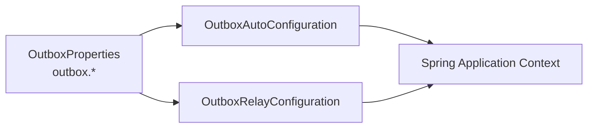

* **Why**: To provide zero-configuration Spring Boot starter ergonomics with conditional bean overrides and type-safe properties.
* **What**: 
  * `OutboxProperties`: Immutable hierarchical configuration record bound to `outbox.*`.
  * `OutboxAutoConfiguration`: Registered in `META-INF/spring/org.springframework.boot.autoconfigure.AutoConfiguration.imports`.
  * `OutboxRelayConfiguration`: Conditional slice for relay, thread pools, and programmatic `SchedulingConfigurer`.
* **How**: Automatically wires all default beans unless custom beans are supplied (`@ConditionalOnMissingBean`).

---

## Configuration Reference (`application.yml`)

```yaml
outbox:
  max-payload-length: 65536        # Max characters allowed in JSON payload (64 KB)
  poll-interval-ms: 5000           # Background polling interval in milliseconds
  relay:
    enabled: true                  # Enable or disable background relay worker
    batch-size: 100                # Number of events to claim per batch
    lease-seconds: 30              # Lock duration for in-flight claimed events
  cleaner:
    retention-days: 7              # Days to retain processed events before purge
    cron: "0 0 2 * * ?"            # Purge schedule (2:00 AM daily)
  retry:
    max-retries: 5                 # Max failures before moving to DEAD_LETTER
    base-interval-ms: 1000         # Initial exponential backoff delay (1s)
    max-interval-ms: 300000        # Maximum backoff cap (5 minutes)
```
